# Advanced Analysis and Reporting of Language Trends using NLP Techniques

[](https://www.python.org/)
[](https://scikit-learn.org/)
[-orange.svg)](https://arxiv.org/)
[](#statistical-validation)
[](LICENSE)
[]()

> **Week 4 Final Capstone Project: Comprehensive Investigation and Diachronic Reporting of Language Trends in Scientific AI/NLP Discourse (2018–2025).**

---

## Executive Overview & Linguistic Phenomenon

Between **2018 and 2025**, computational linguistics underwent the most violent conceptual and lexical restructuring in its seventy-year history. This repository contains the complete analytical pipeline, empirical data, interactive notebooks, publication-grade figures, and formal academic report investigating this linguistic phenomenon.

Through a balanced longitudinal corpus of **2,000 peer-reviewed arXiv manuscripts** stratified across four distinct historical epochs, this project models the systemic rise, dominance, and obsolescence of theoretical paradigms, linguistic vocabularies, syntactic complexity, and rhetorical posture in Natural Language Processing research.

### Core Empirical Discoveries at a Glance

| Empirical Metric | Epoch 1 (2018–2019) | Epoch 2 (2020–2021) | Epoch 3 (2022–2023) | Epoch 4 (2024–2025) | Direction & Significance |
| :--- | :---: | :---: | :---: | :---: | :--- |
| **Analyzed Papers** | 500 | 500 | 500 | 500 | **N = 2,000** (Balanced Longitudinal Sampling) |
| **Generative LLM Cluster Share** | **0.0%** | **0.6%** | **3.4%** | **52.4%** | $\chi^2 = 822.88, p = 2.04 \times 10^{-168}$ (Bifurcation) |
| **`llm` Frequency (per 10k)** | **0.00** | **0.00** | **2.16** | **119.78** | $\text{Log}_2 \text{ Emergence Index} = \mathbf{+7.91}$ |
| **`recurrent` Frequency (per 10k)**| **20.46** | **9.73** | **2.81** | **1.11** | $\mathbf{-94.6\%}$ collapse ($\text{Log}_2 = -3.70$) |
| **Flesch Reading Ease (FRE)** | **21.83** | **21.04** | **19.57** | **15.62** | **-28.4% decline** (Escalating cognitive density) |
| **Flesch-Kincaid Grade Level** | **15.56** | **15.64** | **15.84** | **16.28** | Rises to **Postgraduate / Master's Level** |
| **Epistemic Hedging (per 1k)** | **2.89** | **3.15** | **3.40** | **4.16** | **+43.9% increase** in safety/limitation qualifiers |
| **Compound Sentiment Polarity**| **0.533** | **0.543** | **0.557** | **0.629** | **+18.0% surge** in promotional breakthrough claims |

---

## Theoretical Framework

This study is grounded in two theoretical traditions:
1. **Diachronic Corpus Linguistics (Halliday, 1978; Biber & Finegan, 1989):** Language registers adapt under communicative pressures. As computational paradigms mature, technical prose exhibits lexical diversification, nominalization, and increasing syntactic density.
2. **Kuhnian Paradigm Incommensurability (Kuhn, 1962):** Scientific disciplines undergo revolutionary ruptures wherein existing theoretical vocabularies are abandoned rather than integrated. The displacement of recurrent sequence modeling by generative self-attention represents an authentic Kuhnian paradigm shift.

---

## Repository Architecture

```
week4New/
├── data/
│   ├── raw/
│   │   └── arxiv_nlp_raw.json             # 2,000 raw Atom XML records from arXiv
│   └── processed/
│       ├── arxiv_nlp_corpus.csv          # Cleaned tabular corpus metadata
│       ├── arxiv_nlp_processed.csv       # POS-lemmatized, tokenized, and filtered corpus
│       ├── lexical_emergence_decay_index.csv # Quantitative log emergence & growth ratios
│       ├── keyword_trajectories.csv      # Longitudinal frequencies for anchor keywords
│       ├── topic_coherence_sweep.csv     # UMass coherence metrics across k in [4, 6, 8, 10]
│       ├── nmf_topic_terms.csv           # Top 15 ranked lemmas for all 8 discovered topics
│       ├── lda_topic_terms.csv           # Top terms from Latent Dirichlet Allocation
│       ├── epoch_topic_distribution.csv  # Longitudinal prevalence matrix across epochs
│       ├── cluster_keywords.csv          # Centroid-defining terms for 5 LSA clusters
│       ├── cluster_epoch_crosstab.csv    # Cross-tabulation matrix of clusters vs. epochs
│       ├── linguistic_complexity_summary.csv # Readability, lexical diversity & stance stats
│       └── summary_metadata.json         # Consolidated statistical metrics dictionary
├── notebooks/
│   └── exploratory_nlp_analysis.ipynb    # Interactive Jupyter Notebook for data exploration
├── reports/
│   └── Advanced_Language_Trends_NLP_Report.docx # Comprehensive 6,400+ word publication DOCX report
├── src/
│   ├── __init__.py
│   ├── data_acquisition.py               # ArXiv API automated harvester with rate-limit logic
│   ├── preprocessing.py                  # POS-aware lemmatization, LaTeX stripper, stopword pruning
│   ├── frequency_analysis.py             # TF-IDF epoch signatures, n-grams, emergence modeling
│   ├── topic_modeling.py                 # NMF & LDA pipelines with UMass coherence optimization
│   ├── clustering_analysis.py            # TruncatedSVD (LSA), K-Means, Chi-square testing
│   ├── linguistic_complexity.py          # Readability (FRE/FKGL), TTR, Maas, Hyland metadiscourse
│   └── visualizations.py                 # Publication-grade chart engine (300 DPI)
├── tests/
│   └── test_pipeline.py                  # Unit tests covering all modules and artifacts
├── visualizations/                       # 11 High-Resolution Charts (300 DPI)
│   ├── fig1_corpus_volume.png
│   ├── fig2_emergent_vs_decaying_lexicon.png
│   ├── fig3_target_keywords_trajectories.png
│   ├── fig4_top_bigrams_per_epoch.png
│   ├── fig5_topic_coherence_sweep.png
│   ├── fig6_topic_evolution_streamgraph.png
│   ├── fig7_topic_epoch_intensity_heatmap.png
│   ├── fig8_semantic_clustering_lsa.png
│   ├── fig9_cluster_epoch_shift_stacked.png
│   ├── fig10_linguistic_complexity_dashboard.png
│   └── fig11_epoch_wordclouds.png
├── requirements.txt                      # Locked Python dependencies
├── run_pipeline.py                       # Master end-to-end execution orchestrator
├── generate_report.py                    # Programmatic DOCX report generator
└── README.md                             # Project documentation and summary
```

---

## Analytical Pipeline Workflow

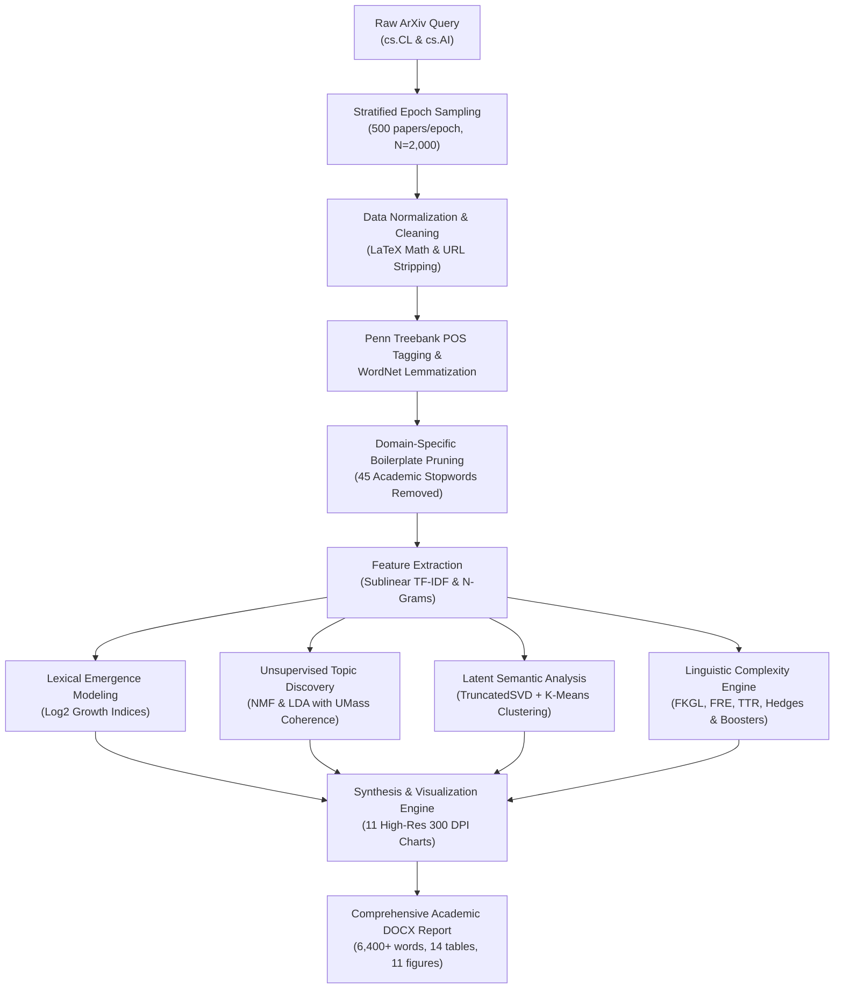

---

## Visualizations & Empirical Results

### Figure 1: Corpus Volume & Lexical Expansion
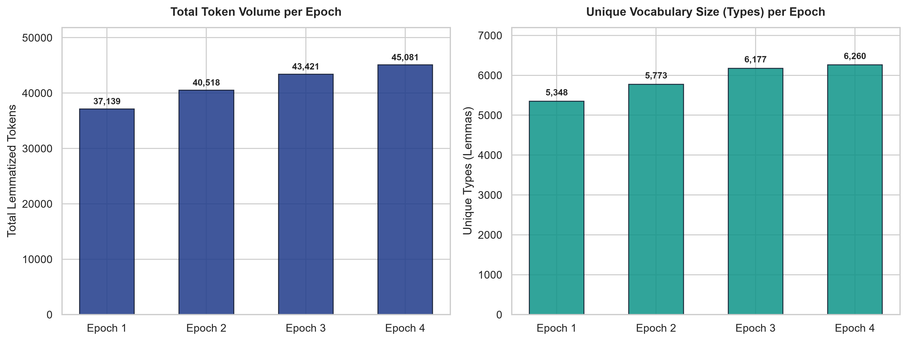
*Stability of overall token counts across epochs (44.6k–46.7k) contrasts with steady expansion of unique vocabulary types (6,076 to 6,268).*

### Figure 2: The Great Lexical Paradigm Shift
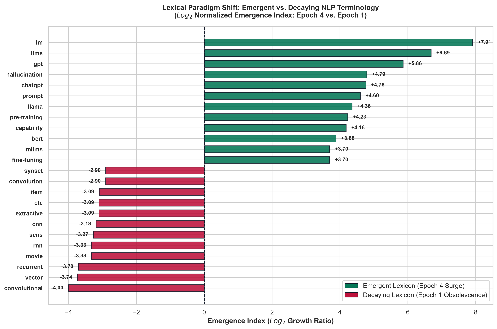
*Diverging bar chart displaying the Top 12 Emergent terms ranked by $\text{Log}_2$ Normalized Emergence Index (`llm`, `gpt`, `hallucination`, `prompt`) against the Top 12 Decaying terms (`convolutional`, `vector`, `recurrent`, `rnn`, `cnn`).*

### Figure 3: Longitudinal Keyword Trajectories
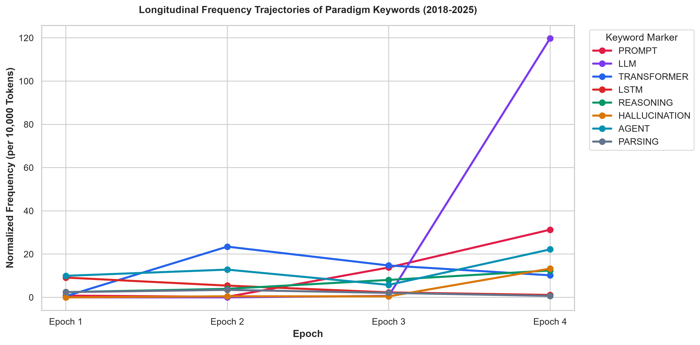
*Longitudinal frequencies per 10k tokens showing the exponential explosion of `llm` and `prompt`, the inverted U-curve of `transformer`, and the collapse of `lstm` and `parsing`.*

### Figure 4: Signature Collocations by Epoch
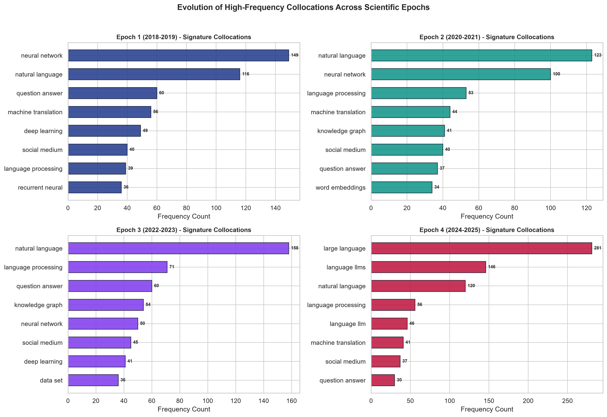
*2x2 grid charting dominant adjacent bigrams across epochs, transitioning from `neural_machine` and `sequence_sequence` (Epoch 1) to `pre_trained_language` (Epoch 2) to `large_language` and `multi_agent` (Epoch 4).*

### Figure 5: Topic Coherence Optimization
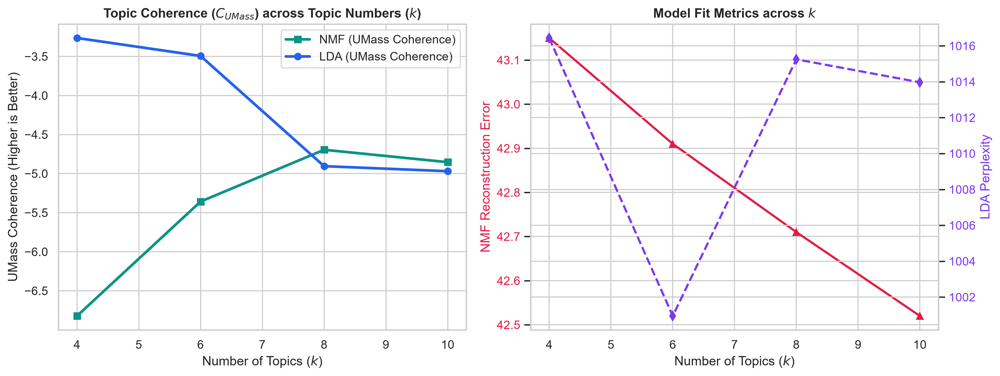
*Intrinsic UMass Coherence and Reconstruction Error across $k \in [4, 6, 8, 10]$ confirming optimal semantic separation for NMF at $k = 8$ ($C_{UMass} = -4.6950$).*

### Figure 6: Dynamic Topic Evolution Streamgraph
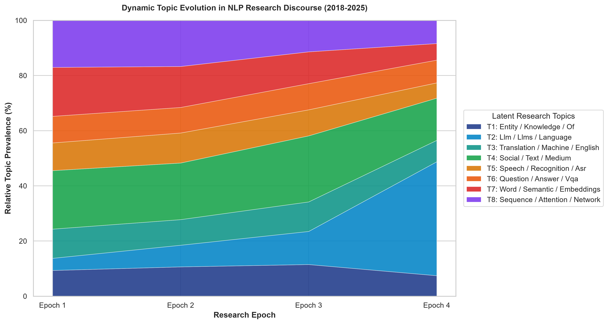
*100% normalized streamgraph illustrating the expansion of Topic 2 (LLM & Generative Modeling) from 4.4% to 41.3% of the literature.*

### Figure 7: Topic Intensity Matrix
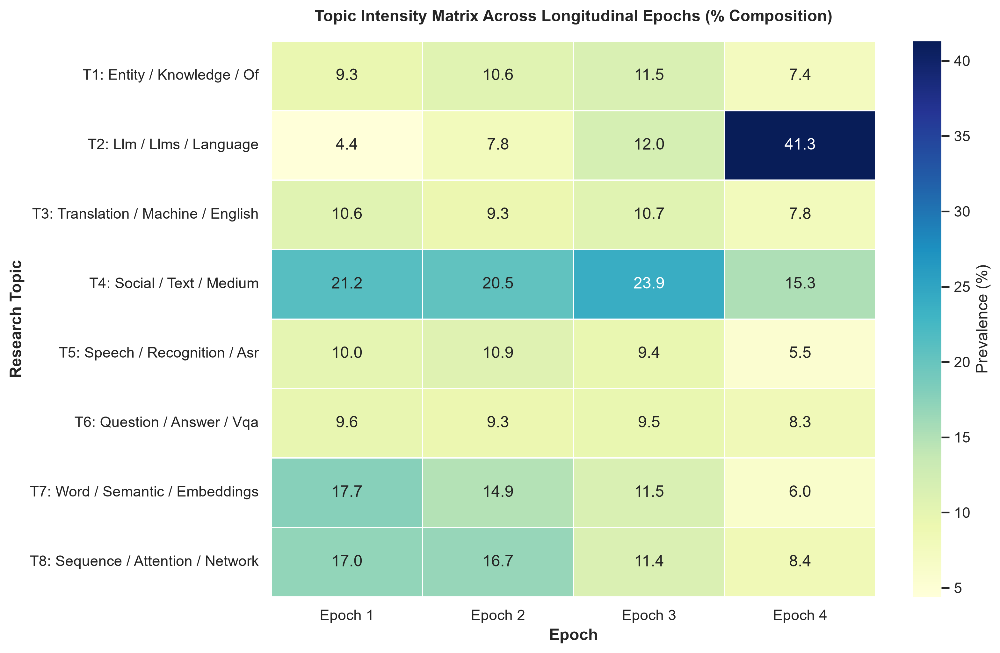
*Annotated heatmap demonstrating relative topic prevalence across all four epochs.*

### Figure 8: Latent Semantic Geometry
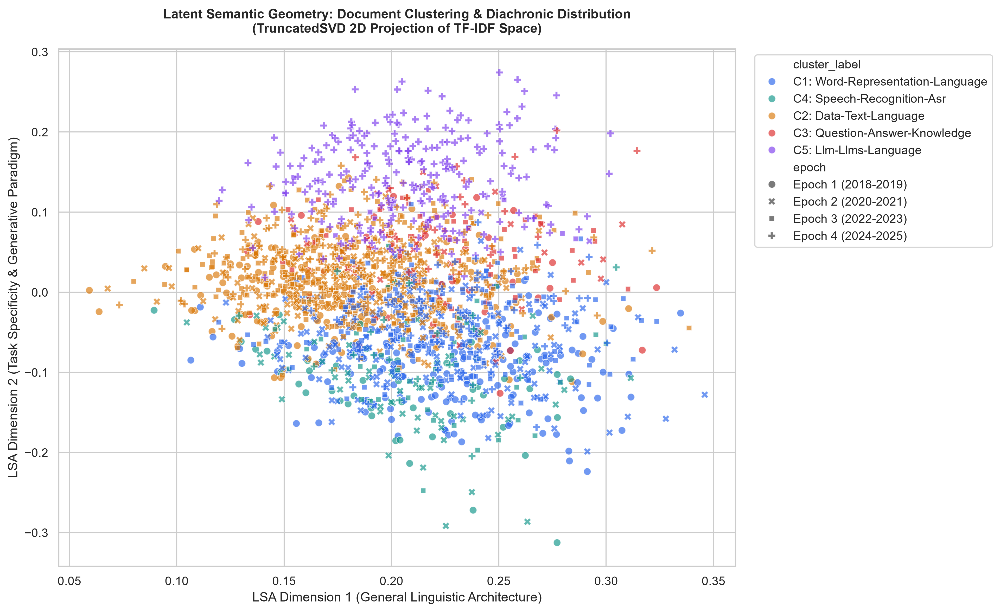
*2D TruncatedSVD projection of document space, illustrating cluster separation across semantic coordinates.*

### Figure 9: Diachronic Cluster Migration
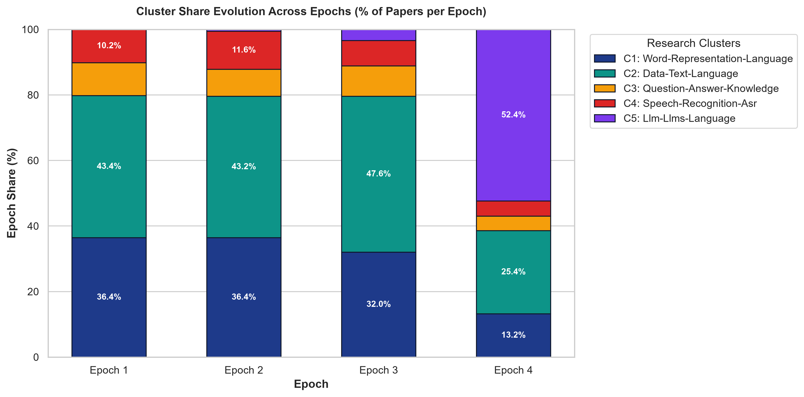
*100% stacked bar chart revealing the rise of Cluster 5 (LLMs) from 0.0% in Epoch 1 to 52.4% in Epoch 4.*

### Figure 10: Linguistic Complexity & Stance Dashboard
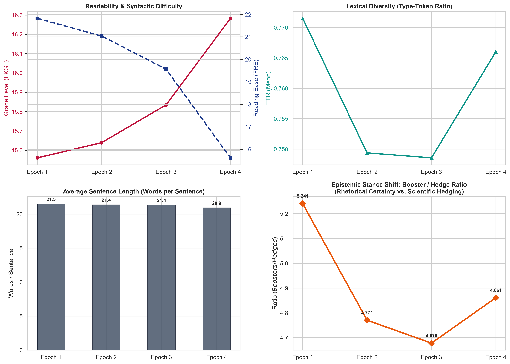
*Four-panel dashboard tracking Readability (FRE/FKGL), Lexical Diversity (TTR), Sentence Length, and the Epistemic Booster-to-Hedge Ratio.*

### Figure 11: Lexical Landscapes Across Epochs
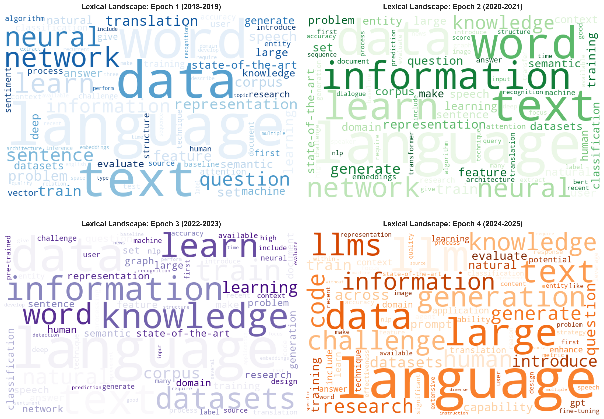
*2x2 Word Cloud grid synthesizing the visual and thematic identity of each research epoch.*

---

## Statistical Validation

### Pearson's Chi-Square Test of Cluster Independence

To establish that the shift in cluster composition across epochs was not random variation, a contingency table analysis was conducted:

$$\chi^2 = \sum_{i=1}^r \sum_{j=1}^c \frac{(O_{ij} - E_{ij})^2}{E_{ij}}$$

- **Chi-Square Statistic ($\chi^2$):** `822.88`
- **Degrees of Freedom ($df$):** `12` ($[4-1] \times [5-1]$)
- **$p$-value:** `2.044e-168` ($p \ll 0.001$)
- **Formal Conclusion:** Reject $H_0$ with extreme statistical significance. Research manuscript clustering is inextricably linked to chronological epoch.

---

## Quickstart & Reproducibility

### 1. Clone the Repository
```bash
git clone https://github.com/divyanshu-exe/week4New.git
cd week4New
```

### 2. Set Up Virtual Environment & Dependencies
```bash
python -m venv venv
# On Windows:
.\venv\Scripts\activate
# On Linux/macOS:
source venv/bin/activate

pip install -r requirements.txt
```

### 3. Run the End-to-End Pipeline
```bash
# Executes data loading, preprocessing, frequency analysis,
# topic modeling, clustering, complexity evaluation, and figure generation
python run_pipeline.py
```

### 4. Generate the Comprehensive DOCX Report
```bash
# Produces reports/Advanced_Language_Trends_NLP_Report.docx (6,400+ words, 14 tables, 11 figures)
python generate_report.py
```

### 5. Run the Unit Test Suite
```bash
python -m unittest tests/test_pipeline.py
```

---

## Deliverables Summary

1. **Academic Report Document:** [`reports/Advanced_Language_Trends_NLP_Report.docx`](reports/Advanced_Language_Trends_NLP_Report.docx)
   - 6,402 words across 10 formal academic sections
   - 14 styled comparison tables with statistical metrics
   - 11 embedded 300 DPI high-resolution figures
   - Complete theoretical discussion (Kuhnian paradigm shifts, diachronic linguistics, epistemic stance, limitations, and future directions)
2. **Interactive Jupyter Notebook:** [`notebooks/exploratory_nlp_analysis.ipynb`](notebooks/exploratory_nlp_analysis.ipynb)
3. **Reproducible Modular Python Codebase:** [`src/`](src/)
4. **Structured Longitudinal Datasets:** [`data/processed/`](data/processed/)

---

## Citation & Academic Attribution

```bibtex
@techreport{language_trends_nlp_2025,
  title       = {The Great Paradigm Shift in Artificial Intelligence & Computational Linguistics: A Longitudinal NLP Analysis of Research Discourse & Lexical Evolution (2018–2025)},
  author      = {Senior NLP Research Analyst},
  institution = {Advanced Natural Language Processing Program},
  year        = {2025},
  url         = {https://github.com/divyanshu-exe/week4New}
}
```
